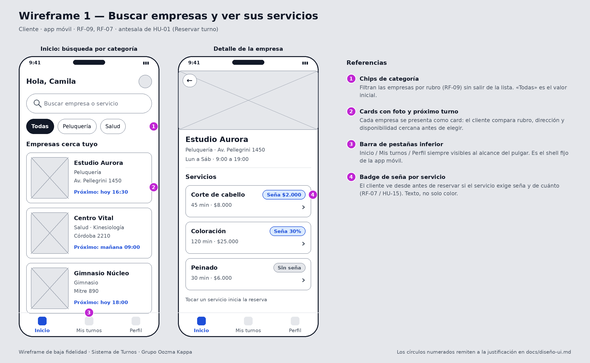
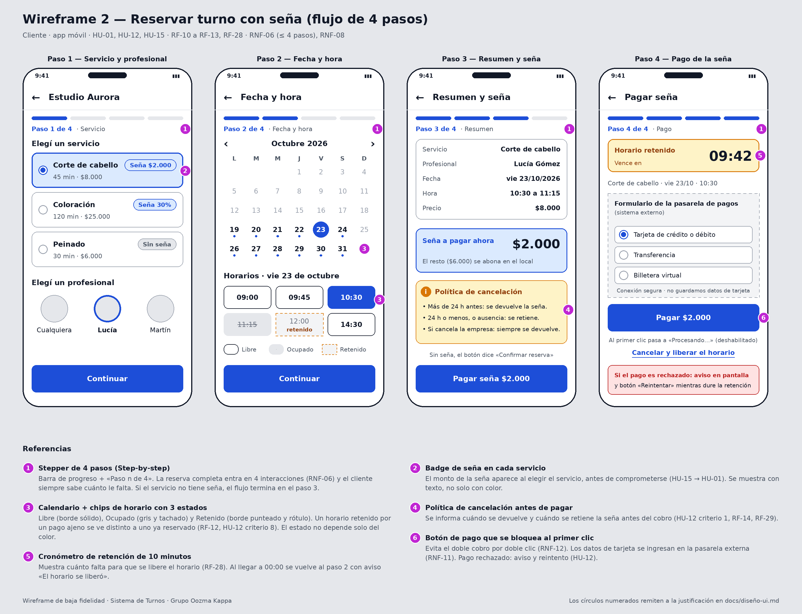
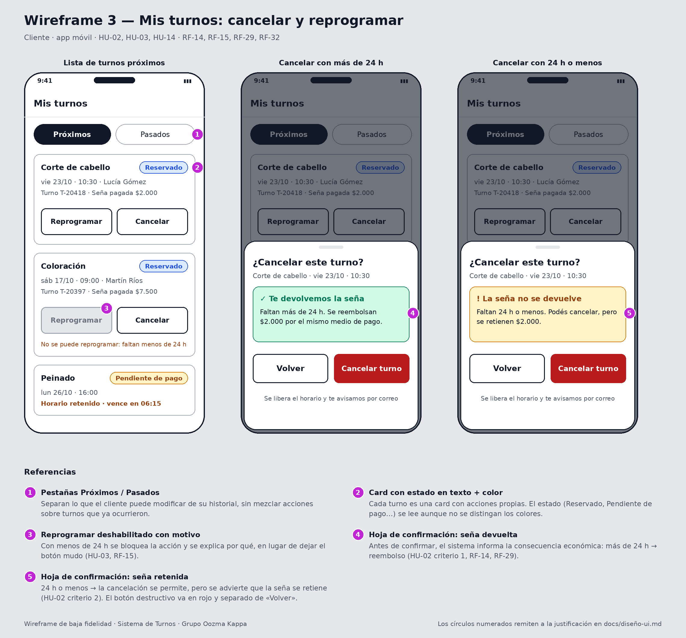
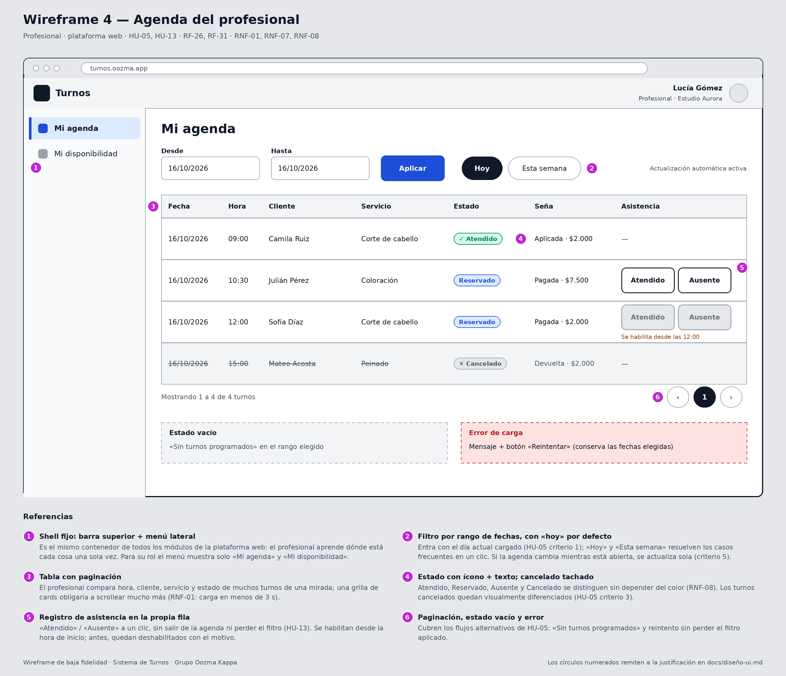
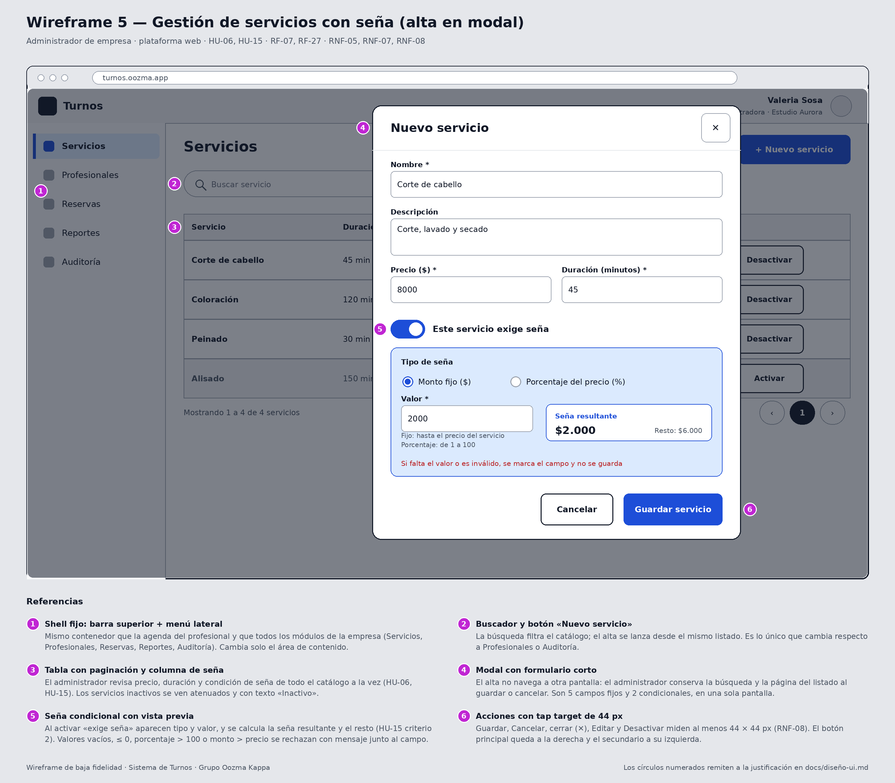

# Diseño UI

_Presentar al menos un wireframe por pantalla o módulo relevante._
_Los wireframes en imagen o PDF van en `diagramas/wireframes/`; acá se documenta la justificación de cada uno._

---

# Diseño UI

_Los wireframes están en `diagramas/wireframes/`; acá se documenta la justificación de cada uno._

**Criterio general.** El sistema tiene dos familias de usuarios con necesidades distintas, y por eso dos "moldes" de interfaz:

- **Cliente (app móvil):** reserva desde el celular, en pocos minutos y muchas veces de pie o en movimiento. Se diseña mobile-first, con un flujo guiado por pasos (RNF-06, RNF-07).
- **Empresa y profesional (plataforma web):** trabajan con volumen (servicios, turnos, registros) y repiten tareas todos los días. Se usa un **shell fijo** (barra superior + menú lateral) con **tablas con paginación** y **modales de formulario corto**, el mismo molde para todos los módulos.

En ambos casos, los datos de tarjeta nunca se ingresan en nuestras pantallas: el pago se resuelve en el formulario de la pasarela externa (RNF-11).

> Decisión de lectura de RNF-06: cada _paso_ es una pantalla del asistente de reserva. El flujo tiene 4 pasos con seña y 3 sin seña.

---

## Pantalla / Módulo 1 — Buscar empresas y ver servicios (cliente)

**Wireframe:** `diagramas/wireframes/01-buscar-empresas.png`

**Patrones de diseño utilizados:** Cards, chips de filtro por categoría, barra de pestañas inferior (shell de la app móvil), lista de servicios con badge de seña.

**Justificación:** El cliente llega sin saber a qué empresa va a ir: compara rubro, dirección y cuándo hay turno cerca (RF-09). Por eso las empresas se muestran como **cards** con foto y "próximo turno", y no como una tabla: acá importa reconocer y comparar entre pocas opciones, no escanear cientos de filas como hace la empresa en su panel. Los **chips de categoría** filtran sin salir de la lista y se alcanzan con el pulgar. La **barra inferior** (Inicio / Mis turnos / Perfil) mantiene la navegación siempre a mano en el celular, que es el dispositivo principal del cliente (README, sección 1.3). En el detalle de la empresa, cada servicio muestra un **badge de seña** ("Seña $2.000", "Seña 30%" o "Sin seña") para que el cliente sepa antes de elegir si va a tener que pagar (RF-07, HU-15); el badge usa texto, no solo color.

**Formulario (si aplica):**
- Cantidad de campos: 1 (búsqueda de texto) + chips de categoría.
- Flujo: todo en una pantalla.
- Validaciones relevantes: sin resultados → mensaje y sugerencia de quitar filtros; solo se listan servicios activos (HU-06 criterio 3).

---

## Pantalla / Módulo 2 — Reservar turno con seña (cliente)

**Wireframe:** `diagramas/wireframes/02-reservar-turno.png`

**Patrones de diseño utilizados:** Step-by-step (stepper de 4 pasos), calendario visual con chips de horario en tres estados, tarjeta de resumen, aviso de política de cancelación, cronómetro de retención, botón de acción única con bloqueo al primer clic.

**Justificación:** Es la historia núcleo del sistema (HU-01) y la que más importa en usabilidad: un cliente nuevo debe completar la reserva en 4 pasos o menos y en menos de 2 minutos (RNF-06). Un **asistente por pasos** muestra una sola decisión por pantalla y un "Paso n de 4" que le dice al cliente cuánto falta; un formulario único en el celular obligaría a scrollear y mezclaría decisiones. Si el servicio no exige seña, el flujo termina en el paso 3 (confirmar).

El **calendario con chips de horario** resuelve el requisito de ver disponibilidad (RF-10) y distingue tres estados: _libre_ (borde sólido), _ocupado_ (gris y tachado) y _retenido_ (borde punteado y rótulo). La diferencia entre ocupado y retenido importa en este caso: un horario retenido por el pago pendiente de otra persona puede volver a liberarse en 10 minutos (RF-12, HU-12 criterio 8), y el cliente tiene que poder entender por qué no puede elegirlo.

Como la seña es dinero, el paso 3 muestra **antes de pagar** el monto, el resto a abonar en el local y la **política de cancelación** (más de 24 h: se devuelve; 24 h o menos: se retiene; si cancela la empresa: siempre se devuelve), tal como piden HU-12 criterio 1 y RF-14/RF-29. En el paso 4, un **cronómetro de 10 minutos** muestra cuánto dura la retención del horario (RF-28) y el **botón de pago se deshabilita al primer clic** para evitar cobros duplicados por doble clic (RNF-12). Si el pago es rechazado, se informa y se permite reintentar mientras dure la retención.

**Formulario (si aplica):**
- Cantidad de campos: 0 campos de texto; 4 selecciones (servicio, profesional, fecha, horario). El medio de pago y los datos de tarjeta se completan en la pasarela externa.
- Flujo: por pasos (4 con seña, 3 sin seña).
- Validaciones relevantes: solo horarios libres seleccionables; el horario se retiene 10 minutos al iniciar el pago; si la sesión expira se vuelve a pedir autenticación; no se genera un segundo cobro por reintento o doble clic; si el pago se acredita con el horario ya tomado, se reembolsa automáticamente y se avisa (HU-12, HU-14).

---

## Pantalla / Módulo 3 — Mis turnos: cancelar y reprogramar (cliente)

**Wireframe:** `diagramas/wireframes/03-mis-turnos.png`

**Patrones de diseño utilizados:** Pestañas (Próximos / Pasados), Cards con badge de estado, acción deshabilitada con motivo, hoja de confirmación (bottom sheet modal) con mensaje según el plazo.

**Justificación:** El cliente gestiona pocos turnos a la vez, así que cada turno es una **card** con sus propias acciones (Reprogramar, Cancelar) y su estado en texto: _Reservado_, _Pendiente de pago_ (con el tiempo restante de retención). Las **pestañas** separan lo que se puede modificar de lo que ya pasó.

Lo más importante de esta pantalla es que **cancelar tiene consecuencias económicas que dependen del plazo** (HU-02, RF-14, RF-29). Por eso la cancelación pasa por una **hoja de confirmación** que, antes de ejecutar, le dice al cliente qué va a pasar con su seña: en verde "Te devolvemos la seña" si faltan más de 24 h, en ámbar "La seña no se devuelve" si faltan 24 h o menos. El botón destructivo ("Cancelar turno") es rojo y está separado de "Volver". Para reprogramar con menos de 24 h, el botón queda **deshabilitado y con el motivo escrito** debajo (HU-03), en lugar de dejar un botón mudo; cuando la reprogramación es posible, la seña pagada pasa al turno nuevo sin cobrar de nuevo (RF-32).

**Formulario (si aplica):**
- Cantidad de campos: 0 (solo confirmación).
- Flujo: lista → hoja de confirmación sobre la misma pantalla; al cerrar vuelve a la lista.
- Validaciones relevantes: el mensaje de la hoja se calcula con el tiempo restante; si el turno ya estaba cancelado se informa y se actualiza la lista (HU-02); el horario liberado queda disponible al instante.

---

## Pantalla / Módulo 4 — Agenda del profesional (web)

**Wireframe:** `diagramas/wireframes/04-agenda-profesional.png`

**Patrones de diseño utilizados:** Shell fijo (barra superior + menú lateral), filtro por rango de fechas con atajos, tabla con paginación, badges de estado con ícono y texto, acciones inline por fila, estados vacío y de error.

**Justificación:** El profesional abre la agenda varias veces al día (CU-05) para organizar su jornada: necesita ver de una mirada hora, cliente, servicio, estado y seña de muchos turnos. Una **tabla** lo permite; una grilla de cards obligaría a scrollear más para la misma información (RNF-01: la consulta debe responder en menos de 3 s). Entra con el **día actual** ya filtrado (HU-05 criterio 1) y los atajos "Hoy" / "Esta semana" cubren los casos frecuentes sin tocar los campos de fecha.

Los estados (Atendido, Reservado, Ausente, Cancelado) se muestran con **ícono y texto**, y los turnos cancelados además aparecen tachados y atenuados (HU-05 criterio 3), de modo que no dependan solo del color. El **registro de asistencia** (HU-13) se hace con dos botones en la propia fila: es una acción repetida muchas veces por día y no justifica abrir otra pantalla ni perder el filtro. Los botones quedan deshabilitados hasta la hora de inicio del turno, con el motivo escrito. El **shell fijo** es el mismo de los demás módulos web, por lo que el profesional aprende la navegación una sola vez; para su rol solo ve "Mi agenda" y "Mi disponibilidad".

**Formulario (si aplica):**
- Cantidad de campos: 2 (Desde, Hasta) + atajos.
- Flujo: todo en una pantalla.
- Validaciones relevantes: "Hasta" no puede ser anterior a "Desde"; sin rango se usa el día actual; sin turnos → "Sin turnos programados"; error de carga → mensaje y "Reintentar" sin perder las fechas (HU-05); la asistencia solo se registra en turnos propios en estado "Reservado" (HU-13).

---

## Pantalla / Módulo 5 — Gestión de servicios con seña (web, empresa)

**Wireframe:** `diagramas/wireframes/05-gestion-servicios.png`

**Patrones de diseño utilizados:** Shell fijo, tabla con paginación y buscador, modal con formulario corto, campos condicionales con vista previa del cálculo.

**Justificación:** El administrador de la empresa revisa y ajusta el catálogo completo (nombre, duración, precio y seña) y lo hace con poca frecuencia pero con muchos registros por revisar (CU-06). La **tabla con búsqueda y paginación** permite comparar precios y condiciones de seña de todos los servicios; los inactivos se ven atenuados y marcados con texto.

El alta y la edición se resuelven en un **modal** y no en otra pantalla: el administrador conserva la búsqueda y la página del listado al guardar o cancelar, que es el mismo criterio que justifica el molde de tablas + modal para todos los módulos web. La configuración de la seña (HU-15) se integra en el mismo modal: al activar **"Este servicio exige seña"** aparecen el tipo (monto fijo o porcentaje) y el valor, y una **vista previa** calcula la seña resultante y el resto ($2.000 / $6.000). Así el administrador ve el efecto de su configuración antes de guardar, en lugar de descubrirlo cuando un cliente reserva.

**Formulario (si aplica):**
- Cantidad de campos: 7 (nombre, descripción, precio, duración, "exige seña", y, solo si exige seña, tipo y valor).
- Flujo: todo en una sola pantalla (modal); no amerita dividirlo en pasos.
- Validaciones relevantes: nombre, precio y duración obligatorios; nombre único dentro de la empresa (HU-06); si exige seña, el valor es obligatorio; porcentaje entre 1 y 100; monto fijo mayor a 0 y no mayor al precio (HU-15); cada cambio queda auditado con fecha y usuario (RNF-05).

---

## Módulos que reutilizan el mismo molde

Los siguientes módulos de la plataforma web combinan los mismos tres patrones (shell fijo, tabla con paginación, modal). Lo único que cambia es el contenido:

| Módulo (historia) | Patrones | Qué cambia respecto a Servicios |
|---|---|---|
| Profesionales (HU-07) | Tabla + Modal | El modal incluye selección múltiple de servicios; no se puede guardar sin al menos uno. Advertencia al desactivar con turnos futuros. |
| Mi disponibilidad (HU-04) | Lista por día + Modal de franja | Franjas agrupadas por día de la semana; el modal pide día, hora de inicio y hora de fin; rechaza superposiciones. |
| Reservas de la empresa (RF-17) | Tabla | Columnas de estado de turno y de seña. Sin modal de alta. |
| Auditoría (HU-10) | Tabla con filtros | Solo lectura, con filtros por fecha, usuario y tipo de operación. |
| Reportes (HU-11) | — | Pendiente: la historia sigue en refinamiento y no cumple el DoR (fórmula de ocupación, formato y filtros sin definir). |

---

## Consideraciones de accesibilidad

_Relacionadas con RNF-08 (contraste mínimo de 4,5:1, operación por teclado y controles de al menos 44 × 44 px) y con los usuarios reales del sistema._

- **El estado nunca depende solo del color.** Un cliente con daltonismo tiene que distinguir un horario libre de uno ocupado o retenido, y un turno "Reservado" de uno "Pendiente de pago". Por eso los horarios usan borde sólido / tachado / borde punteado con el rótulo "retenido", y los estados de turno llevan ícono y texto (✓ Atendido, ✕ Cancelado).
- **Tap targets de al menos 44 × 44 px en los botones de uso frecuente.** Los profesionales (peluquería, estética, kinesiología) marcan "Atendido" / "Ausente" entre un cliente y otro, muchas veces con las manos ocupadas o desde una tablet en el mostrador; esos botones, y los de Guardar, Cancelar y cerrar (✕) de los modales, miden 44 px de alto como mínimo. En los wireframes móviles, los chips de categoría (32 px), los de horario (40 px) y las celdas del calendario (34 px) quedan por debajo de 44 px: hay que ampliar su área táctil en la versión final para cumplir RNF-08.
- **Navegación completa por teclado en la plataforma web.** Los modales mueven el foco al primer campo al abrirse, lo mantienen dentro mientras están abiertos, se cierran con Esc y devuelven el foco al botón que los abrió ("+ Nuevo servicio"). La tabla de agenda permite llegar a los botones de asistencia con Tab.
- **Formularios con etiqueta explícita y errores asociados al campo.** Cada campo (nombre, precio, duración, valor de la seña) tiene un `label` visible, no solo un placeholder, y el mensaje de error se vincula con `aria-describedby` para que un lector de pantalla lo anuncie junto al campo.
- **Cronómetro de retención sin ruido.** El contador de 10 minutos del pago no se anuncia segundo a segundo a un lector de pantalla: se avisa con `aria-live="polite"` cuando quedan 5 minutos, 1 minuto y cuando el horario se libera, para que no interrumpa el ingreso del pago.
- **Contraste.** El texto principal y secundario usa colores con relación de contraste superior a 4,5:1 sobre fondo blanco; los avisos ámbar y verde combinan texto oscuro sobre fondo claro. Los botones deshabilitados no cuentan para el requisito, pero siempre muestran el motivo en texto con contraste suficiente.